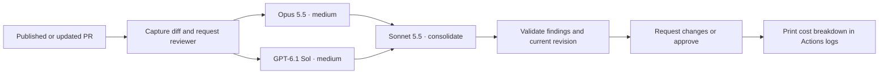

# AI Reviewer

Two independent PR reviews: **Claude Opus 5.5** and **GPT-6.1 Sol**, both at medium
reasoning effort. **Claude Sonnet 5.5** groups duplicate findings and writes the
summary. One configurable GitHub account submits the review and inline threads.



## Install in a repository

1. Give your reviewer account collaborator access to the target repository.
   Create its personal access token with review permissions. The original setup
   uses `njalexander93-ai` and a classic token with `public_repo` scope.
   The username is resolved from the token; it is not hard-coded.
2. Add these **repository Actions secrets to each target repository**:

   | Secret | Value |
   | --- | --- |
   | `ANTHROPIC_API_KEY` | Anthropic API key with access to both Claude models |
   | `OPENAI_API_KEY` | OpenAI API key with access to GPT-6.1 Sol |
   | `AI_REVIEWER_TOKEN` | Reviewer's GitHub personal access token |

3. Copy [the caller workflow](examples/ai-review.yml) into the target repository
   as `.github/workflows/ai-review.yml`. Replace both `REVIEWER_RELEASE_COMMIT_SHA` placeholders with the same reviewed,
   full commit SHA from a release of this repository. The template is not deployable
   until those placeholders are replaced.
   Merge the caller into the target's default branch.
4. Enable **dismiss stale pull request approvals when new commits are pushed**
   in the target's branch protection or ruleset. Keep existing tests and required
   human reviews. This automation does not configure merge rules.
5. Open or update a non-draft PR. Check the workflow's **Report API costs** step for usage.
   An existing PR needs an update or manual workflow dispatch after installation.

The shared workflow runs **inside the calling repository's Actions run**. It uses
that repository's secrets, permissions, logs and artifacts. It does not discover
or enable itself on every repository in an account.

For a fork of this reviewer, update the caller's `uses:` repository and supply
`implementation-repository: your-account/your-reviewer` under `with:`. Replace both
commit pins and supply your own secrets. Never put credentials in workflow YAML.

See GitHub's documentation for [reusable workflows and explicit secrets](https://docs.github.com/en/actions/how-tos/reuse-automations/reuse-workflows),
[token scopes](https://docs.github.com/en/apps/oauth-apps/building-oauth-apps/scopes-for-oauth-apps),
and [stale approval dismissal](https://docs.github.com/en/repositories/configuring-branches-and-merges-in-your-repository/managing-protected-branches/about-protected-branches).
Private targets need a credential with access to them; a `public_repo` token is
insufficient.

## Test the implementation branch

[Branch review test](.github/workflows/review-branch.yml) runs on non-draft PR
updates from the same-repository `feat/automated-pr-review` branch. It calls the
local reusable workflow and checks out the same PR merge commit, so both workflow
logic and Python implementation come from the candidate revision. This exercises
real provider calls, posts a real review and incurs API charges. Fork PRs and
other branches do not qualify. The ordinary Checks workflow still runs separately.

GitHub resolves [local reusable workflows from the caller's commit](https://docs.github.com/en/actions/how-tos/reuse-automations/reuse-workflows).
This bootstrap caller does not need to exist on `main` before its PR event runs.
Remove it after this implementation branch is merged. This repository's production
caller uses its local reusable workflow and the same trusted commit for checkout.
External repositories use the release-pinned installation template. Re-running a test can incur model costs
even when publication detects an existing review.

## Review policy

- Runs on PR opening, reopening, publication from draft, and new commits.
- Same-repository PRs run automatically. Fork PRs require a maintainer to select
  **Run workflow** and enter the PR number. Draft, closed and reviewer-authored
  PRs are rejected. Requests serialize per repository and PR.
- Each model receives the same diff, complete before/after versions of changed
  text files, PR description and previous inline discussion. Before versions
  come from the merge base, matching the PR diff.
- The imported [thermo-nuclear review skill](src/ai_reviewer/prompts/review.md)
  supplies the structural quality standard. Correctness and security findings
  also count. Models must report insufficient context explicitly.
- Sonnet sees both completed reports. It must preserve every finding exactly
  once. Original wording and severity remain attached to grouped inline threads.
- Any blocking finding means **REQUEST_CHANGES**. Two complete reports with no
  blockers mean **APPROVE**. Nonblocking observations may accompany approval.
- Missing, invalid or incomplete results fail the run. They never become a clean
  verdict. Both head and base commits are rechecked immediately before posting.
- Re-running the same head/base pair does not duplicate a published review.
  Model calls still incur charges on reruns.

## Security and limits

The workflow checks out only its pinned reviewer implementation. It reads PR
content through GitHub's API and never executes PR code, installs its packages,
or exposes shell tools to models. One job performs setup once and runs both independent reviews concurrently in a
single step. Both provider API keys are available to that step; only preparation
and publication receive the reviewer credential. All stages share the runner and
workspace, so step-scoped environment variables are not a sandbox boundary.

**This is a bounded static review, not a replacement for the interactive agents.**
It cannot inspect unchanged dependencies, run tests, browse links or verify an
entire repository architecture. When those are necessary, models should mark the
review incomplete. Model judgment can still be wrong or affected by malicious
instructions in source; structured output does not eliminate that risk.

Limits are 80 changed files, 150 KB per file version and 600 KB of total serialized
context. Missing text patches are reconstructed from the captured file versions.
Binary files, unavailable content and oversized changes fail without
approval. Each model may return up to 40 findings. Output is capped at 16,000
tokens per call. No automatic provider retries are performed.

GitHub review submission is not atomic with the final revision check. A push in
that small interval can leave a review attached to the old commit. Enable stale
approval dismissal as described above. A failed subsequent run does not retract
older reviews by itself.

Review context and model reports are Actions artifacts retained for one day.
They contain source and discussion. Treat their access as part of the calling
repository's trust boundary. Public review text and Actions logs must not contain
secrets. The CLI deliberately suppresses provider exception bodies.

## Cost reporting

The final **Report API costs** step prints Opus, Sol and Sonnet estimates, Claude/OpenAI
subtotals and a combined total. It runs after success or failure. Missing usage
is **unknown**, never silently counted as free. Review comments contain no cost
accounting.

Estimates use provider-reported input, output and cache token counts. Rates are
recorded in [models.py](src/ai_reviewer/models.py), checked on **2026-10-23** against
[Anthropic pricing](https://platform.claude.com/docs/en/about-claude/pricing) and
[OpenAI pricing](https://developers.openai.com/api/docs/pricing). They exclude tax,
credits and GitHub Actions charges. Update rates when provider pricing changes;
provider billing remains authoritative. Configure spending limits in each API
project independently.

## Development

Use **Python 3.14.8** and **Poetry 2.4.2**, matching the nplet development baseline.

```sh
poetry env use python3.14
poetry sync
poetry run pre-commit install
poetry check --lock
poetry run ruff format --check .
poetry run ruff check --no-fix .
poetry run mypy
poetry run pytest --cov --cov-report=term-missing
```

Open the repository root in VS Code, install `.vscode/extensions.json`
recommendations and select `.venv`. Editor settings, Python ignore rules,
formatting, typing and test tools are adapted from nplet. Commit `poetry.lock`.

Tests use synthetic GitHub and provider boundaries. They exercise artifact
handoff, approval guards, stale revisions, inline anchors, consolidation fidelity
and cost calculations without paid API calls. CI runs formatting, linting,
typing and tests, with an 80% branch-aware coverage floor.

### Source documentation

Follow the source-documentation pattern used in nplet and plainspoken across
production code, scripts and tests:

- Begin each module with its responsibility, boundary and relevant side effects.
- Give every named class, function and method a meaningful Google-style docstring.
  Use `Args`, `Returns`, `Raises` and `Attributes` where the contract needs them.
  Document constraints and failure conditions rather than repeating type hints.
- Introduce each logical phase of a multi-step routine with a concise comment.
  Together, the comments should explain the flow: input selection, validation,
  transformation, I/O, state changes and failure handling. Group related statements;
  do not narrate each assignment. Single-operation helpers need only a docstring.
- Describe what the code actually does, including limitations. Preserve vendored
  prompts and licenses rather than restyling third-party material.
- Review documentation manually as well as running Ruff. For documentation-only
  Python edits, compare syntax trees with docstrings removed and inspect runtime
  consumers of documentation. Here, argparse uses the CLI module docstring and
  Pydantic includes contract class docstrings in provider-facing schema descriptions.

## License and attribution

[MIT](LICENSE). The vendored review prompt is copied from the supplied local
`thermo-nuclear-code-quality-review` skill, based on the
[Cursor team kit skill](https://github.com/cursor/plugins/blob/main/cursor-team-kit/skills/thermo-nuclear-code-quality-review/SKILL.md).
Its upstream [MIT license](src/ai_reviewer/prompts/LICENSE.cursor) is included.

The [prompt manifest](src/ai_reviewer/prompts/manifest.json) records the verified
upstream commit, immutable source URLs, SHA-256 hashes and local modifications.
