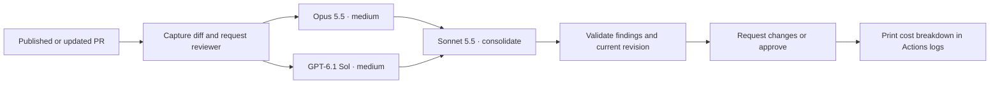

# AI Reviewer

Two independent PR reviews: **Claude Opus 5.5** and **GPT-6.1 Sol**, both at medium
reasoning effort. **Claude Sonnet 5.5** groups duplicate findings and writes the
summary. One configurable GitHub account submits the review and inline threads.



## Install in a repository

1. Give your reviewer account collaborator access to the target repository.
   Create its personal access token with review permissions. The original setup
   uses `njalexander93-ai` and a classic token with `public_repo` scope.
   The username is resolved from the token; it is not hard-coded.
2. Add these **repository Actions secrets to each target repository**:

   | Secret | Value |
   | --- | --- |
   | `ANTHROPIC_API_KEY` | Anthropic API key with access to both Claude models |
   | `OPENAI_API_KEY` | OpenAI API key with access to GPT-6.1 Sol |
   | `AI_REVIEWER_TOKEN` | Reviewer's GitHub personal access token |
   | `LINEAR_API_KEY` (optional) | Linear personal API key with read access to relevant issues |

3. Copy [the caller workflow](examples/ai-review.yml) into the target repository
   as `.github/workflows/ai-review.yml`. Replace both `REVIEWER_RELEASE_COMMIT_SHA` placeholders with the same reviewed,
   full commit SHA from a release of this repository. The template is not deployable
   until those placeholders are replaced.
   Merge the caller into the target's default branch.
4. Enable **dismiss stale pull request approvals when new commits are pushed**
   in the target's branch protection or ruleset. Keep existing tests and required
   human reviews. This automation does not configure merge rules.
5. Open or update a non-draft PR. Check the workflow's **Report API costs** step for usage.
   An existing PR needs an update or manual workflow dispatch after installation.

The shared workflow runs **inside the calling repository's Actions run**. It uses
that repository's secrets, permissions, logs and artifacts. It does not discover
or enable itself on every repository in an account.

For a fork of this reviewer, update the caller's `uses:` repository and supply
`implementation-repository: your-account/your-reviewer` under `with:`. Replace both
commit pins and supply your own secrets. Never put credentials in workflow YAML.

See GitHub's documentation for [reusable workflows and explicit secrets](https://docs.github.com/en/actions/how-tos/reuse-automations/reuse-workflows),
[token scopes](https://docs.github.com/en/apps/oauth-apps/building-oauth-apps/scopes-for-oauth-apps),
and [stale approval dismissal](https://docs.github.com/en/repositories/configuring-branches-and-merges-in-your-repository/managing-protected-branches/about-protected-branches).
Private targets need a credential with access to them; a `public_repo` token is
insufficient.

## Review policy

- Runs on PR opening, reopening, publication from draft, and new commits.
- Same-repository PRs run automatically. Fork PRs require a maintainer to select
  **Run workflow** and enter the PR number. Draft, closed and reviewer-authored
  PRs are rejected. Requests serialize per repository and PR.
- Small packets retain two independent whole-packet reviews with complete before/after
  text. Both sizes use the same manifest, source validation and consolidation flow.
  Larger snapshots use deterministic chunks and two reviews of every required
  local/integration assignment. Each packet includes PR metadata, the full issue
  requirements, a changed-file inventory and relevant previous inline discussion.
  Before versions come from the merge base, matching the PR diff.
- Context uses validated file/comment records and omits repeated GitHub diff hunks
  and URL/user metadata. Symlinks retain their actual link text and Git mode.
- The imported [thermo-nuclear review skill](src/ai_reviewer/prompts/review.md)
  supplies the structural quality standard. Correctness and security findings
  also count. Models must report insufficient context explicitly.
- Sonnet sees completed reports and findings in bounded batches. It must preserve every finding exactly
  once. Original wording and explicit severity labels remain in feedback. Different
  locations receive separate threads; large groups split between findings at a
  conservative 60,000 UTF-8 byte limit per inline comment.
- Any blocking finding means **REQUEST_CHANGES**. All required complete reports with no
  blockers mean **APPROVE**. Nonblocking observations may accompany approval.
- Missing, invalid or incomplete results fail the run. They never become a clean
  verdict. Both head and base commits are rechecked immediately before posting.
- Re-running the same head/base pair does not duplicate a published review.
  Model calls still incur charges on reruns.

## Issue context

Each preparation collects issue titles, descriptions, states and source URLs once
and passes the same snapshot to both reviewers. Neither provider needs an issue:
GitHub only, Linear only, both and neither are supported. Duplicate references
within a provider produce one issue record.

- **GitHub:** uses the existing `GH_TOKEN`, with `issues: read` in the caller and
  reusable workflow. Reads linked issues (including manual Development links),
  plus `owner/repo#123` and `https://github.com/owner/repo/issues/123`
  references in the PR title/body. Local references require an issue keyword,
  such as `Fixes #123`, `Refs #123`, `Issue #123` or `Related to #123`, so colours
  and numeric URL fragments are not mistaken for tickets. Other PRs are excluded.
  GitHub authentication remains required for the review itself.
- **Linear:** add `LINEAR_API_KEY` to the target repository's Actions secrets.
  Missing or empty means no Linear lookup. With a key, reads Linear attachments
  matching the PR URL and ticket IDs such as `ENG-123` in the PR title, body or
  branch name, including Linear issue URLs and lowercase branch IDs. IDs must
  match a team visible to the key, so ordinary terms such as `UTF-8` are ignored.
  Team discovery is bounded to 100 teams and fails if the list is incomplete.
- **Failures:** configured-provider errors, inaccessible referenced issues and
  truncated results fail preparation. They never silently mean "no issue."
  Collection allows at most 20 issues and 20 explicit references per provider;
  issue text counts toward every packet’s 600,000-byte context limit.
- **Scope:** refreshes on review runs, not on issue edits alone. Does not crawl
  project boards, infer tickets from similar wording, or read issue comments.
  A GitHub token must have access to every referenced repository; the default
  workflow token may not access issues in another private repository.

Issue contents are untrusted requirements, not reviewer instructions. Linear
content is sent to both model providers and saved in the calling repository's
review artifacts. Use a key scoped to data appropriate for that repository;
review feedback may quote issue requirements.

API contracts: [GitHub linked issues](https://docs.github.com/en/graphql/reference/pulls),
[Linear attachments by URL](https://linear.app/developers/attachments), and
[Linear issue lookup and personal API keys](https://linear.app/developers/graphql).

The Linear attachment query uses `attachmentsForURL(url: String!, first: Int)`
returning `AttachmentConnection!`, with `nodes` and `pageInfo`. This is verified
against Linear's [published SDK schema](https://github.com/linear/linear/blob/618a737a4e6aa279b7853c650f79f209a5142bbc/packages/sdk/src/schema.graphql#L39017-L39046),
not a flat attachment list. Mock fixtures preserve that provider contract;
authenticated live validation remains deferred.

## Failure diagnostics

Failed stages and model calls emit bounded JSON diagnostics to Actions logs and
`*.error.json` files in the evidence artifact. Model records identify the role,
model and phase (`preflight`, `generation`, or `validate_response`). Worker logs
identify assignment, provider and zero-based attempt. Numeric HTTP status and up
to 20 schema errors include known field names, array indexes and validation codes.
Unknown field names are redacted; response bodies, exception messages, validation
inputs/context, credentials and headers are never included. SDK parse failures
can still leave token usage unknown. Logging does not make a failed review pass.

These diagnostics run only when the workflow uses this implementation revision.
The production caller uses the implementation on `main`; updating an unmerged PR
does not change the reviewer executing against that PR.

## Security and limits

The workflow checks out only its pinned reviewer implementation. It reads PR
content through GitHub's API and never executes PR code, installs its packages,
or exposes shell tools to models. One job performs setup once and runs both independent reviews concurrently in a
single step. Both provider API keys are available to that step; only preparation
and publication receive the reviewer credential. All stages share the runner and
workspace, so step-scoped environment variables are not a sandbox boundary.

**This is a bounded static review, not a replacement for the interactive agents.**
It can retrieve captured changed-file sections, but cannot inspect unchanged dependencies,
run tests, browse links or verify an
entire repository architecture. When those are necessary, models should mark the
review incomplete. Model judgment can still be wrong or affected by malicious
instructions in source; structured output does not eliminate that risk.

### Large PRs

The **600,000-byte ceiling applies to serialized UTF-8 context per call**, including
source, patches, requirements, replies and the shared overview. It is a starting
safeguard, not a measured optimum. Preparation now permits up to 3,000 changed
files, 8 MB per blob and 32 MB per serialized snapshot. These collection bounds
replace the old 80-file and 150 KB per-version rejection.

1. Capture immutable head, base and merge-base evidence. Validate that original
   patches account for the complete before/after change. Reconstruct missing
   text patches with Git over inert blobs. Binary, unreadable, truncated or
   unsupported objects still fail without approval.
2. Keep a whole file when it fits the unit budget. For oversized text, prefer
   Python function/class boundaries, then diff sections, then physical patch
   lines. Other languages use diff boundaries. Retain original patch records,
   old/new cursors, source offsets, modes, renames and final-newline state.
3. Compile the inventory and discussion index once per plan. Scan each captured
   version with a shared reference index using complete path/module tokens. Join
   normalized names only between test and non-test files. Reuse this relationship evidence during packing and integration.
   Pack direct references, source/test pairs and directory peers together using
   stable ordering. Fit checks count precomputed item bytes incrementally; full
   packets are serialized only after their scopes are chosen. A unit is capped at 160,000 bytes so two actual source units
   can accompany reports during integration. Local packets target 420,000 bytes,
   leaving 180,000 bytes for required follow-ups under the 600,000-byte ceiling.
   Indivisible oversized lines or required metadata fail explicitly; nothing is
   silently removed to fit.
4. Run Opus and Sol, both at medium effort, on every chunk with **two concurrent
   workers** in the same Actions job. Each provider can request up to eight source
   ranges per response from the captured changed files. Allow two follow-up rounds.
   All earlier findings and requested source remain available. Unresolved context,
   an unavailable range or an oversized follow-up makes the run incomplete.
5. Both providers perform integration passes with actual source and reports.
   Every chunk gets an integration pass. Additional packets join direct references,
   source/test pairs and neighboring directory/file sections across chunks. Direct
   references come from full captured blobs, with their actual source lines included
   even outside changed hunks. Accumulated reports are paged into additional required
   integration assignments. This
   is a bounded heuristic, **not a complete dependency graph**. Models must request
   missing source and remain incomplete if the snapshot cannot answer.
6. Recompute the plan and validate the coverage manifest once before consolidation
   and once before publication. The manifest stores assignment and plan hashes;
   full payloads stay in attempt artifacts. Reports are keyed by assignment and
   provider. Compile immutable diff anchors once per stage and reuse them across
   workers and replay. Whole, local and integration assignments receive explicit
   scope instructions with the same source-request contract. Require both providers for all assignments and all follow-ups.
   Coverage proves assignment/completion; it does not prove model understanding.
7. Sonnet groups up to 40 original findings per batch with global source IDs.
   All findings, locations and severity survive exactly once. Cross-batch duplicate
   findings remain separate. Bounded summary passes carry original assessments
   and disagreements into one overview. Publication submits **one GitHub review**.

Provider token counts are checked before generation, including instructions and
output schemas. Each call allows at most **250,000 input tokens** and **16,000
output/reasoning tokens**. This conservative policy leaves headroom below the
verified [Claude 1M context](https://platform.claude.com/docs/en/models/overview)
and [Sol 1.05M context](https://developers.openai.com/api/docs/models/gpt-6.1-sol)
and stays below Sol's 272k long-context price threshold. Bytes are not converted
into guessed tokens. See [Claude token counting](https://platform.claude.com/docs/en/build-with-claude/token-counting)
and [OpenAI token counting](https://developers.openai.com/api/docs/guides/token-counting).
Count both provider inputs for every planned local scope before either generates
a report, including packets already routed to chunks.
If any exceeds capacity, re-plan with a 200,000-byte ceiling for every review
packet, including integration pages and follow-ups. Local chunks target half that
ceiling and source units at most one quarter, leaving integration headroom.
Each resulting call still undergoes provider token counting; there is no byte/token
conversion or guarantee that required metadata can fit. The fallback plan is bound
to the manifest and replayed by downstream stages. Other provider failures remain
failures, not partitioning signals.

Operational defaults are deliberate finite safeguards, not performance optima:

| Boundary | Default | Reason |
| --- | --- | --- |
| Collection | 3,000 files; 8 MB/blob; 32 MB snapshot; 10,000 API requests/client; 20,000 direct relations | Bound fetching and memory while admitting both historical examples |
| Local planning | 64 chunks | Bound partition growth |
| Local + integration work | 128 assignments, each reviewed by both providers | Bound relationship expansion and spending |
| Follow-ups | 3 total attempts/provider/assignment | Resolve missing evidence without an open-ended loop |
| Provider output | 40 findings and 60,000 serialized bytes/attempt | Bound report handling and integration input |
| Sonnet work | 128 finding batches + 128 summary calls | Bound aggregate consolidation |
| Publication | 1,000 comments; 8 MB comment payload; 60,000-byte body | Fail before any oversized or partial review write |
| Job | 2 workers; 180 minutes; no automatic API retries | Bound concurrency and execution time |

Application work limits live in `src/ai_reviewer/limits.py`; the job timeout lives
in the workflow. Increasing one requires reviewing downstream bounds. Equal values
with different purposes remain separate. The work limits are **not a dollar budget**. Large PRs can cost substantially more through repeated overview/source,
follow-ups and integration. There is no promise that an accepted snapshot will
finish: required evidence, output or total work may exceed a later bound, which
blocks approval. The **180-minute job timeout is the effective wall-clock limit**;
the assignment and per-call maxima cannot all be exhausted within it. Timeout may
interrupt a stage. Cost reporting and artifact upload use `always()`, but their
completion after job cancellation is not established. A timed-out run may therefore
lose usage/evidence and must never be treated as a clean review. A new run needs a fresh
artifact directory, as supplied by a new Actions job.

See [measured examples and validation limits](docs/chunking-validation.md).

GitHub review submission is not atomic with the final revision check. A push in
that small interval can leave a review attached to the old commit. Enable stale
approval dismissal as described above. A failed subsequent run does not retract
older reviews by itself.

Review context and model reports are Actions artifacts retained for one day.
They contain source, discussion and issue context. Treat their access as part of the calling
repository's trust boundary. Public review text and Actions logs must not contain
secrets. The CLI deliberately suppresses provider exception bodies.

## Cost reporting

The final **Report API costs** step reads every nested attempt artifact and prints
Opus, Sol and Sonnet estimates, Claude/OpenAI
subtotals and a combined total. It runs after success or failure. An attempted
call with unavailable usage is **unknown**, never silently counted as free. A
stage never attempted is reported as **not run ($0)**. Review comments contain
no cost accounting.

Estimates use provider-reported input, output and cache token counts. Rates are
recorded in [models.py](src/ai_reviewer/models.py), checked on **2026-10-23** against
[Anthropic pricing](https://platform.claude.com/docs/en/about-claude/pricing) and
[OpenAI pricing](https://developers.openai.com/api/docs/pricing). They exclude tax,
credits and GitHub Actions charges. Update rates when provider pricing changes;
provider billing remains authoritative. Configure spending limits in each API
project independently.

## Development

Use **Python 3.14.8** and **Poetry 2.4.2**, matching the nplet development baseline.

```sh
poetry env use python3.14
poetry sync
poetry run pre-commit install
poetry check --lock
poetry run ruff format --check .
poetry run ruff check --no-fix .
poetry run mypy
poetry run pytest --cov --cov-report=term-missing
```

Open the repository root in VS Code, install `.vscode/extensions.json`
recommendations and select `.venv`. Editor settings, Python ignore rules,
formatting, typing and test tools are adapted from nplet. Commit `poetry.lock`.

Tests use synthetic GitHub and provider boundaries. They exercise artifact
handoff, approval guards, stale revisions, inline anchors, consolidation fidelity
and cost calculations without paid API calls. CI runs formatting, linting,
typing and tests, with an 80% branch-aware coverage floor.

### Source documentation

Follow the source-documentation pattern used in nplet and plainspoken across
production code, scripts and tests:

- Begin each module with its responsibility, boundary and relevant side effects.
- Give every named class, function and method a meaningful Google-style docstring.
  Use `Args`, `Returns`, `Raises` and `Attributes` where the contract needs them.
  Document constraints and failure conditions rather than repeating type hints.
- Introduce each logical phase of a multi-step routine with a concise comment.
  Together, the comments should explain the flow: input selection, validation,
  transformation, I/O, state changes and failure handling. Group related statements;
  do not narrate each assignment. Single-operation helpers need only a docstring.
- Describe what the code actually does, including limitations. Preserve vendored
  prompts and licenses rather than restyling third-party material.
- Review documentation manually as well as running Ruff. For documentation-only
  Python edits, compare syntax trees with docstrings removed and inspect runtime
  consumers of documentation. Here, argparse uses the CLI module docstring and
  Pydantic includes contract class docstrings in provider-facing schema descriptions.

## License and attribution

[MIT](LICENSE). The vendored review prompt is copied from the supplied local
`thermo-nuclear-code-quality-review` skill, based on the
[Cursor team kit skill](https://github.com/cursor/plugins/blob/main/cursor-team-kit/skills/thermo-nuclear-code-quality-review/SKILL.md).
Its upstream [MIT license](src/ai_reviewer/prompts/LICENSE.cursor) is included.

The [prompt manifest](src/ai_reviewer/prompts/manifest.json) records the verified
upstream commit, immutable source URLs, SHA-256 hashes and local modifications.

## Final merge checklist

- [ ] Complete the last candidate review and record its passing run.
- [ ] Keep required code-quality checks passing on the final revision.
